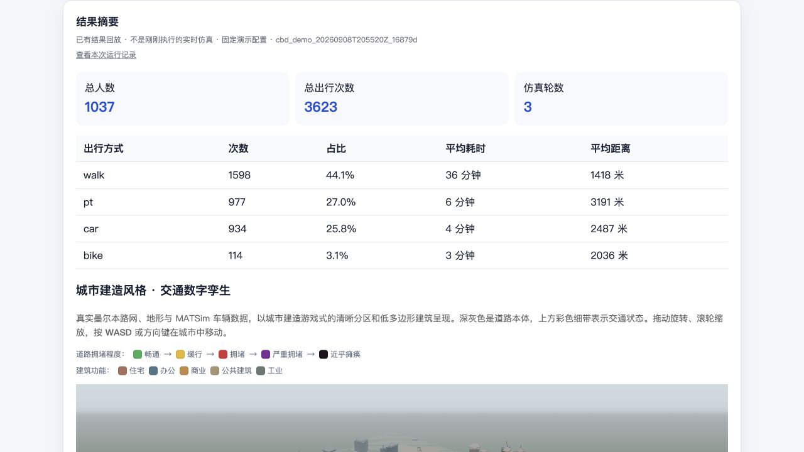
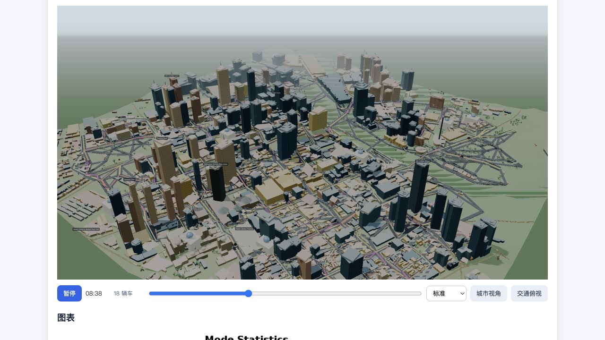

# MATSim Melbourne Pipeline Demo

[](https://github.com/kangshuming0111-ctrl/matsim-melbourne-pipeline-demo/actions/workflows/python-tests.yml)

[简体中文说明](README.zh-CN.md)

A local, auditable prototype that connects Melbourne transport data preparation,
MATSim simulation, result analysis, and an interactive 3D replay behind one
Python CLI and web interface.

The current goal is deliberately narrow: run one small Melbourne CBD scenario
end to end, preserve evidence for that run, and make the difference between a
new simulation and a historical replay explicit. This repository does **not**
claim that the model is calibrated, predictive, or validated against observed
traffic conditions.





## What is demonstrated

```text
OSM road network + ABS/VISTA-derived aggregate inputs
  -> region-matched network and synthetic population
  -> generated MATSim configuration
  -> multi-modal MATSim run
  -> events, plans, scores and CSV outputs
  -> summary charts and interactive Three.js replay
```

The fixed `cbd_small_v1` profile uses:

| Setting | Value |
|---|---|
| Region | `data/sample_region.geojson` (small Melbourne CBD polygon) |
| Network / SA1 buffer | 500 m |
| Demand sample | 5% |
| Upstream `numPlans` parameter | 500 (not a hard cap on final agents) |
| Demand seed | 4711 |
| MATSim seed | 4711 |
| Iterations | 0, 1 and 2 (three recorded iterations) |
| CRS | EPSG:7899 |
| Public transport | Teleported fixed-speed `pt`, not a full GTFS service model |

Five additional inner-Melbourne presets remain experimental. The Greater
Melbourne boundary is retained only as a large-network stress-test input; it is
not presented as an end-to-end verified scenario.

## Upstream work and project contribution

This repository integrates existing open-source MATSim Melbourne components:

- `vendor/network/`: upstream R network generation from OpenStreetMap.
- `vendor/demand/`: upstream R synthetic population and activity-plan generation
  using ABS/VISTA-derived inputs.
- `vendor/baseline/`: upstream Java/Maven MATSim baseline scenario.

The project-specific integration is mainly in:

- `docker/`: pinned R and Java build/runtime environments.
- `wrapper/`: Python CLI, FastAPI service, serial background jobs, preflight
  checks, region matching, orchestration, analysis, provenance records and 3D
  scene export.
- `tests/`: Python reliability tests for validation, failure handling, run-ID
  binding, input pinning and selected visualization logic.
- targeted compatibility changes in vendored entry points for container paths,
  deterministic seeds, Apple Silicon/Rosetta execution, parallel workers and
  writable GDAL temporary storage.

This is not a rewrite of MATSim or the upstream population model. The upstream
projects and their retained notices remain visible so the integration work is
not confused with upstream authorship.

## Technology used

- Python 3.10+: CLI, orchestration, FastAPI, job state, analysis and provenance.
- R: upstream geospatial network and demand-generation workflows.
- Java 11 and Maven: MATSim baseline runner.
- Docker Desktop: isolated R and Java environments.
- Three.js: local-browser 3D terrain, buildings, roads and vehicle replay.
- GeoJSON, OSM PBF, GeoPackage/SQLite, CSV, XML and gzipped MATSim outputs.

## Quick start

### Prerequisites

- Python 3.10 or newer.
- Docker Desktop with at least 8 GB assigned; 24 GB or more is recommended.
- The external data described in [Data preparation](docs/DATA_PREPARATION.md).

On macOS, double-click `start.command`. It creates a project-local `.venv`,
installs `requirements.txt` when needed, checks Docker, starts the service and
opens the browser.

The equivalent manual setup is:

```bash
python3 -m venv .venv
source .venv/bin/activate
python3 -m pip install -r requirements.txt
python3 -m wrapper.cli doctor
python3 -m uvicorn wrapper.api:app --host 127.0.0.1 --port 8000
```

Open <http://127.0.0.1:8000/>. API documentation is available at
<http://127.0.0.1:8000/docs>.

Run the fixed demo from the terminal with:

```bash
python3 -m wrapper.cli demo
```

Each execution receives a unique run ID and does not overwrite previous output.

## Auditable run records

For a run named `<run_id>`, the pipeline writes:

```text
output/<run_id>_network/
output/<run_id>_demand/
output/<run_id>_sim_config/config.xml
output/<run_id>_sim/
output/run_records/<run_id>/run_manifest.json
output/run_records/<run_id>/pipeline.log
```

The manifest records the code state, configuration, random seeds, non-sensitive
input metadata, dependency-file fingerprints, Docker version and image IDs,
start/finish times, stage status, log locations, result locations, and final
artifact checks. It intentionally excludes environment variables, host names,
user names, passwords, tokens and raw data contents.

The web UI clears any displayed result before a new run starts. A failed job has
no result payload, a result with the wrong run ID is rejected, and failed run
records are not shown as completed. Historical results are labelled
**Existing result replay — not a newly executed simulation**.

## Verified local execution

On 9 September 2026 (Melbourne time), the fixed profile was rerun into a new
output directory:

- 684 network nodes and 2,464 links.
- 1,037 synthetic agents and 3,623 trips.
- three MATSim score rows for iterations 0, 1 and 2.
- all 16 required artifacts present and non-empty.
- normal MATSim shutdown, with no unexpected-termination marker.
- elapsed time: approximately 14 minutes 46 seconds, including a required image
  rebuild and Maven dependency retrieval.

Only the privacy-reviewed summary is published; raw inputs and full simulation
outputs are not. See [Verified run and test summary](docs/VERIFIED_RUN.md).

## Tests

```bash
python3 -m unittest discover -s tests -v
```

The latest clean project-local environment run discovered 22 tests: 22 passed,
0 failed, 0 errors and 0 skipped. The tests cover API input restrictions,
missing-data preflight behavior, durable job history, external-stage failure,
run/result identity checks, failed-run filtering, exact OSM input selection,
GDAL temporary-directory configuration, Docker source fingerprints,
deterministic seed propagation, and selected 3D style helpers.

The legacy upstream R demand tests are not all green in the current pinned
container: after supplying the CRS expected by the fixture, one byte-level
`plan.csv` MD5 snapshot still differs and four plotting warnings remain. The
snapshot was not deleted or regenerated. See the public verification summary
for the exact distinction between software validation and model validation.

## Repository layout

```text
wrapper/       Python product layer and Three.js web interface
docker/        Docker build configurations
vendor/        retained upstream R/Java projects and their tests/licenses
tests/         project-specific Python tests
scripts/       optional one-off data preparation utilities
data/          tracked region boundaries only; large runtime data is ignored
docs/          screenshots and privacy-reviewed validation notes
output/        generated locally and ignored by Git
```

## Known limitations

- Only `cbd_small_v1` has a fresh, complete local validation record.
- The 69.1% network/demand coverage value is a bounding-box diagnostic, not a
  strict polygon-containment or model-quality measure.
- The three-iteration demo does not establish convergence.
- There is no comparison with observed traffic counts, predictive-accuracy
  result, travel-time improvement or real-world transport impact.
- Full GTFS transit vehicles, stops and timetables are not integrated.
- Large source datasets still require manual preparation and are not distributed
  in this repository.
- The 3D building categories, colours and some roof forms aid legibility; they
  are not a photogrammetric reconstruction of every building.
- The web UI is a local prototype, not a production service or desktop installer.

## Data and licensing

Large OSM, ABS/VISTA-derived, terrain, landmark-cache and simulation-output files
are intentionally excluded. Follow [docs/DATA_PREPARATION.md](docs/DATA_PREPARATION.md)
and the upstream documentation under `vendor/*/data/`.

Vendored components retain their original license files or declarations. See
[Third-party notices](THIRD_PARTY_NOTICES.md) for source and license details.
No new top-level license is granted for the integration code in this snapshot;
add one only after the repository owner has chosen the intended reuse terms.
